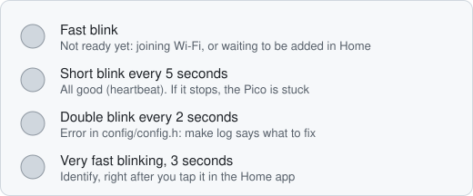

# Troubleshooting

Start with the [LED](#the-led) and the log:

```bash
make log
```

`make log` prints everything the Pico says and keeps going across reboots. To type commands
such as `status`, use `make monitor` instead (quit with Ctrl-A then X).

## The LED



`make log` prints a `led:` line each time the pattern changes, with the reason.

| What you see | What to do |
|---|---|
| Never lights up | Normal for the first seconds after power-on (up to about 20 s the first time after a setup-code change). If it stays dark and `make log` shows nothing, check the USB cable and reflash with `make flash` (hold BOOTSEL while plugging in if the Pico doesn't respond). |
| Fast blink that never stops | Check the log: `led: not ready (fast blink): joining Wi-Fi` means the Pico can't join Wi-Fi (see [Wi-Fi](#wi-fi)); `waiting to be added in the Home app` means it works but isn't paired yet (see [Adding the bridge to Home](#adding-the-bridge-to-home)). |
| Double blink | `config/config.h` has an error. The log repeats the message every 10 s: `fix the sensor list…` (a bad MAC or bind key) or `fix HAP_SETUP_CODE…`. Fix it and `make flash`. |
| Heartbeat (short blink every 5 s) stopped | The firmware is stuck. Unplug and replug the Pico, and keep `make log` running to catch what happens before it stops again. |

## Wi-Fi

The log shows `wifi: ...` lines with the reason:

| Log message | Cause |
|---|---|
| `network not found (2.4 GHz? in range?)` | Wrong `WIFI_SSID`, the network is 5 GHz only, or the Pico is out of range. The Pico W only does 2.4 GHz. |
| `authentication failed (wrong password?)` | Wrong `WIFI_PASSWORD`. |
| `no connection after 30 s ..., restarting` | The router accepted the Pico but gave no IP address. The Pico retries on its own, alternating WPA2/WPA3 and WPA2; check the router's DHCP and any MAC filtering. |

## Adding the bridge to Home

- **The bridge doesn't appear under "More options…"**:
  - The iPhone must be on the same network as the Pico, not a guest network. Some routers
    block the multicast (mDNS) that Home uses to find accessories; look for "client isolation"
    or "multicast" settings.
  - If the LED shows the heartbeat, the Pico is already paired with a home and hides itself.
    To add it to another home, run `unpair` in `make monitor` first.
- **"Setup code incorrect"**: compare with the code `status` prints in `make monitor`. After
  each wrong try the Pico makes you wait longer before the next one (1, 2, 4 … up to 60 s;
  the log says `pair-setup refused: retry in N s`).
- **The step after the code takes a while**: normal, about 8 seconds.

## In the Home app

- **"No Response" forever** after you removed the bridge from Home while the Pico was off: the
  Pico still thinks it's paired. Run `unpair` and add it again.
- **"No Response" now and then**: check `make log` for `wifi:` lines (Wi-Fi drops) or a reboot
  (`pico2homekit starting`). Moving the Pico closer to the router helps.
- **Thermometers swapped names or rooms** after editing `SENSOR_LIST`: Home knows each
  thermometer by its position in the list. Fix them in Home, or see
  [CONFIGURATION.md](CONFIGURATION.md).

## Thermometers

| Log message | Cause |
|---|---|
| no lines for a thermometer at all | Out of range, flat battery, or wrong MAC. Each thermometer only broadcasts every few seconds and one value at a time: give it a minute. |
| `ble: Xiaomi device not in config: A4:C1:38:...` | A Xiaomi device the Pico can hear but isn't in `SENSOR_LIST`. If it's yours, the MAC in the config is wrong. |
| `ble: <name>: decryption failed (wrong key?)` | Wrong bind key (or it changed because the thermometer was re-added to Mi Home). Get the key again. |
| `ble: <name>: unencrypted frame ... (ignored)` | Someone nearby is sending fake readings for that MAC, or the thermometer runs custom firmware. They are ignored on purpose. |

`make mac-ble` reads the thermometers with the Mac's Bluetooth using the same config, so you
can check MACs and keys without the Pico ([MAC_BLE.md](MAC_BLE.md)). Battery level can take a
few minutes to appear after a reboot.

## Flashing and the serial port

- **`No Pico serial port found`**: the Pico is in BOOTSEL (a drive called `RPI-RP2` is mounted;
  run `make flash`), it isn't plugged in, or the cable is charge-only.
- **`make flash` can't reboot the Pico**: quit `make monitor` first; it keeps the port busy.
  If the Pico still doesn't respond, hold BOOTSEL while plugging it in and run `make flash`.
- **The Pico doesn't start after flashing**: unplug and replug it. If it keeps happening, hold
  BOOTSEL while plugging in and flash again.
- **`minicom not found`**: install it ([SETUP.md](SETUP.md#8-minicom)) or use `make log`.

## Starting over

| Command (in `make monitor`) | Effect |
|---|---|
| `unpair` | forgets all paired iPhones/homes; the bridge keeps its identity. Add it again in Home. |
| `reset` | new HomeKit identity: Home sees a brand-new accessory. Remove the old one from Home first. |
